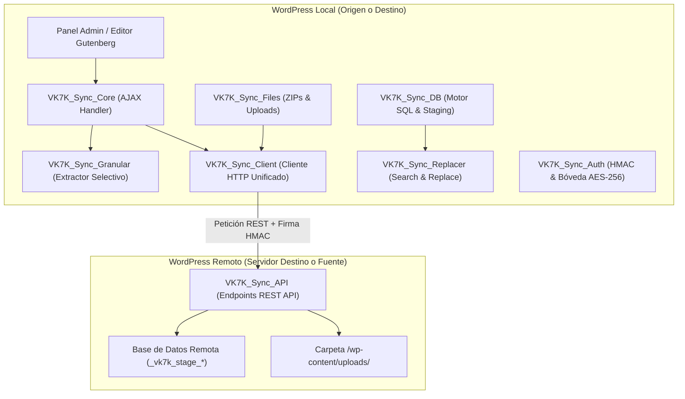

# Arquitectura y Catálogo de Métodos - `vk7k-wp-sync` (uxcribe.cl Sync)

> **Versión:** 1.6.6  
> **Autor:** Uxcribe.cl  
> **Propósito:** Sincronización y clonación bidireccional (Push / Pull) de WordPress para bases de datos complejas (WooCommerce, postmeta, options, FSE) con Search & Replace serializado recursivo, sincronización granular desde el editor de bloques (Gutenberg) y transferencia de archivos por lotes/SFTP vía REST API autenticada por HMAC-SHA256.

---

## 1. Visión General del Sistema y Flujo de Datos

---

## 2. Mapa de Clases y Responsabilidades

| Clase | Archivo | Responsabilidad Principal |
|---|---|---|
| **`VK7K_Sync_Client`** | `includes/class-vk7k-sync-client.php` | **Cliente HTTP Unificado**: Envoltura limpia para llamadas REST remotas (POST, GET, Binario octet-stream y descarga en streaming). |
| **`VK7K_Sync_Runner`** | `includes/class-vk7k-sync-runner.php` | **Orquestador Principal**: Ejecuta el wizard de sincronización por pasos (Init, DB, FSE, Archivos, SFTP, Finalize) y auto-despliegue del plugin. |
| **`VK7K_Sync_Granular`** | `includes/class-vk7k-sync-granular.php` | **Motor de Sincronización Selectiva**: Inspecciona y exporta contenidos específicos (Posts, Páginas, Productos, FSE) resolviendo recursivamente postmeta, términos, y medios físicos en Gutenberg y Elementor. |
| **`VK7K_Sync_DB`** | `includes/class-vk7k-sync-db.php` | **Motor de Base de Datos**: Extracción e inserción por chunks en tablas de staging temporales (`_vk7k_stage_*`), backup de administradores, rollback y Search & Replace profundo. |
| **`VK7K_Sync_Files`** | `includes/class-vk7k-sync-files.php` | **Gestor de Archivos y Medios**: Manifiestos de archivos, cálculo de diferencias (diff), empaquetado/desempaquetado ZIP y cliente SFTP. |
| **`VK7K_Sync_API`** | `includes/class-vk7k-sync-api.php` | **Controlador REST API**: Expone las rutas bajo el namespace `/wp-json/vk7k-sync/v1/` con validación estricta de firmas HMAC. |
| **`VK7K_Sync_Auth`** | `includes/class-vk7k-sync-auth.php` | **Seguridad y Bóveda**: Cifrado AES-256-CBC, gestión de perfiles multi-destino (Staging, Producción), PIN de acceso y generación/verificación de firmas HMAC-SHA256. |
| **`VK7K_Sync_Core`** | `includes/class-vk7k-sync-core.php` | **Controlador de Hooks y AJAX**: Registra los hooks de activación/desactivación y los 35+ endpoints AJAX para la interfaz gráfica y el editor. |
| **`VK7K_Sync_Replacer`** | `includes/class-vk7k-sync-replacer.php` | **Motor de Reemplazo Recursivo**: Search & Replace con preservación de longitudes en objetos serializados de PHP (`s:X:`) y datos JSON escapados. |
| **`VK7K_Sync_Admin`** | `admin/class-vk7k-sync-admin.php` | **Vistas de Administración y Editor**: Menú de WordPress (`Uxcribe`), encolado de estilos/scripts en WP-Admin y assets para Gutenberg / FSE. |

---

## 3. Catálogo de Métodos Públicos

### `VK7K_Sync_Client`
*Punto de entrada recomendado para cualquier llamada al servidor remoto.*
- `VK7K_Sync_Client::post( $endpoint, $body, $remote_url, $secret_key )`: Realiza una petición POST enviando un payload JSON y decodificando la respuesta automáticamente.
- `VK7K_Sync_Client::post_binary( $endpoint, $raw_data, $remote_url, $secret_key )`: Envía datos binarios directos (`application/octet-stream`) con fallback automático a Base64.
- `VK7K_Sync_Client::stream_download( $endpoint, $body, $temp_destination, $remote_url, $secret_key )`: Descarga un archivo ZIP en streaming directo hacia disco.

### `VK7K_Sync_Granular`
- `inspect_entities()`: Retorna post types públicos, taxonomías y menús para la ventana de selección.
- `query_items( $args )`: Consulta paginada y filtrable de posts, páginas, productos y CPTs.
- `query_terms( $taxonomy, $search, $page, $per_page )`: Consulta de términos de taxonomías.
- `query_options( $search, $page, $per_page )`: Consulta de opciones de `wp_options`.
- `export_package( $selection )`: Empaqueta posts seleccionados o resueltos por slug con todas sus dependencias completas (imágenes destacadas, adjuntos, galerías WooCommerce, bloques internos Gutenberg, Elementor y sub-tamaños físicos).
- `inspect_single_post( $post_id )`: Retorna en tiempo real el conteo de medios, metadatos y términos para el panel de Gutenberg.

### `VK7K_Sync_Files`
- `generate_manifest( $components, $options )`: Genera el inventario de archivos (tamaño, mtime, hash).
- `calculate_diff( $source_manifest, $dest_manifest )`: Compara inventarios y lista archivos nuevos o modificados.
- `create_zip_chunk( $rel_paths, $max_bytes, $max_files )`: Comprime archivos respetando límites de memoria y tamaño.
- `extract_zip_chunk( $zip_path )`: Extrae un archivo ZIP recibido, normalizando rutas hacia `ABSPATH` y `/wp-content/uploads/`.
- `send_specific_files_to_remote( $remote_url, $secret_key, $rel_paths )`: Envía una lista de archivos a remoto vía REST.
- `pull_specific_files_from_remote( $remote_url, $secret_key, $media_files )`: Descarga archivos específicos desde remoto con verificación individual.
- `cleanup_temp( $force )`: Limpia archivos temporales ZIP creados durante transferencias.

### `VK7K_Sync_DB`
- `get_tables( $options )`: Lista las tablas del sitio con tamaños y conteos.
- `get_table_schema( $table_name )`: Extrae el DDL de creación de la tabla.
- `export_table_chunk( $table_name, $offset, $limit, $replacer, $target_prefix, $is_schema_only )`: Extrae filas aplicando Search & Replace en memoria.
- `import_table_chunk( $chunk_data, $is_first_chunk, $schema_sql )`: Inserta filas en tablas de staging (`_vk7k_stage_*`).
- `commit_staged_tables( $target_url )`: Pasa las tablas de staging a producción atómicamente y restaura administradores.
- `cleanup_staged_tables()`: Elimina tablas temporales de staging.
- `backup_admin_users()` / `restore_admin_users( $prefix )`: Protege los usuarios administradores locales.
- `backup_preserved_options()` / `restore_preserved_options( $stage_table )`: Preserva opciones del sistema receptor.
- `create_rollback_backup()` / `restore_rollback_backup()`: Respaldo de seguridad previo a clonaciones totales.

### `VK7K_Sync_Auth`
- `get_active_target()`: Retorna el perfil remoto activo (URL, credenciales descifradas).
- `switch_active_target( $target_id )`: Cambia de entorno activo (ej. de Staging a Producción).
- `save_target( $target_data )` / `delete_target( $target_id )`: Administra perfiles remotos.
- `setup_pin( $pin )` / `verify_pin( $pin )` / `unlock_vault( $pin )` / `lock_vault()`: Sistema de seguridad de bóveda.
- `generate_auth_headers( $action, $payload, $secret_key )`: Genera firmas HMAC-SHA256, timestamps y nonces.
- `verify_request( $request )`: Middleware de autenticación REST.

---

## 4. Directorio de Rutas REST API (`/wp-json/vk7k-sync/v1/`)

Todas las rutas requieren autenticación HMAC con cabeceras `X-VK7K-Signature`, `X-VK7K-Timestamp` y `X-VK7K-Nonce`.

| Ruta | Método | Controlador | Descripción |
|---|---|---|---|
| `/auth/test` | POST | `handle_auth_test` | Prueba de handshake y verificación de claves. |
| `/sync/init` | POST | `handle_init` | Inicializa receptor y activa modo mantenimiento. |
| `/sync/finalize` | POST | `handle_finalize` | Finaliza la sincronización y regenera enlaces. |
| `/db/tables` | POST | `handle_db_tables` | Lista tablas disponibles en el receptor. |
| `/db/export-chunk` | POST | `handle_db_export_chunk` | Exporta un bloque de filas SQL. |
| `/db/import-chunk` | POST | `handle_db_import_chunk` | Inserta un bloque en tablas de staging. |
| `/db/push-posts` | POST | `handle_db_push_posts` | Upsert masivo de posts, postmeta y terms. |
| `/db/push-options` | POST | `handle_db_push_options` | Upsert selectivo en `wp_options`. |
| `/granular/inspect`| POST | `handle_granular_inspect` | Inspección de entidades disponibles. |
| `/granular/query`  | POST | `handle_granular_query` | Consulta de items paginados. |
| `/granular/export` | POST | `handle_granular_export` | Extrae paquete granular con dependencias y medios. |
| `/granular/import` | POST | `handle_granular_import` | Importa paquete granular en la base de datos. |
| `/files/manifest`  | POST | `handle_files_manifest` | Genera inventario de archivos remotos. |
| `/files/upload-chunk` | POST | `handle_files_upload_chunk` | Recibe lote ZIP y lo descomprime en destino. |
| `/files/download-chunk` | POST | `handle_files_download_chunk` | Empaqueta y transmite archivos en streaming. |

---

## 5. Endpoints AJAX (`admin-ajax.php`)

Los endpoints AJAX están protegidos por `check_ajax_referer( 'vk7k_sync_admin_nonce' )` y chequeo de capacidades (`manage_options` o `edit_posts`):

- **Editor Gutenberg / FSE:**
  - `vk7k_sync_editor_inspect`: Inspecciona dependencias del post actual.
  - `vk7k_sync_editor_push`: Envía el post actual + medios al remoto.
  - `vk7k_sync_editor_pull`: Trae el post actual desde el remoto y descarga medios.
- **DataGrid Granular:**
  - `vk7k_sync_granular_inspect`, `vk7k_sync_granular_query`, `vk7k_sync_granular_run`.
- **Clonación Global:**
  - `vk7k_sync_init`, `vk7k_sync_db_step`, `vk7k_sync_files_step`, `vk7k_sync_finalize`.
- **Bóveda y Credenciales:**
  - `vk7k_sync_unlock_vault`, `vk7k_sync_setup_pin`, `vk7k_sync_switch_target`.

---

## 6. Política de Compatibilidad hacia Atrás (Backward Compatibility)

Para garantizar que servidores con versiones desfasadas sigan comunicándose sin fallos:
1. **Ningún endpoint REST se elimina**: Si una ruta se vuelve redundante, se delega internamente a la nueva.
2. **Métodos deprecados**: Se marcan con `@deprecated` y redirigen internamente al método canónico en lugar de eliminarse inmediatamente.
3. **Manejo de rutas de medios**: Se soportan tanto prefijos relativos `wp-content/uploads/` como `uploads/`.
